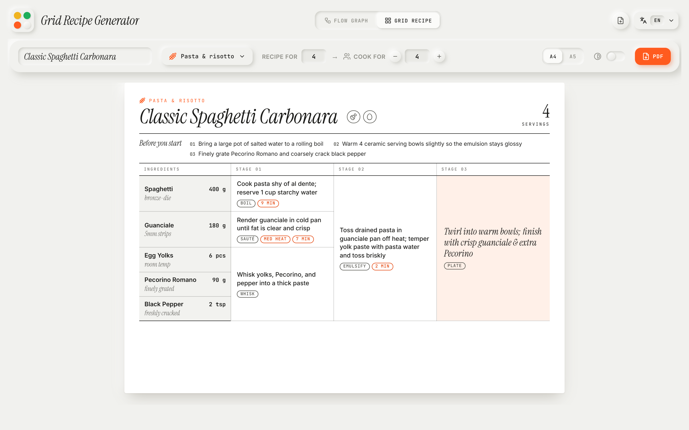
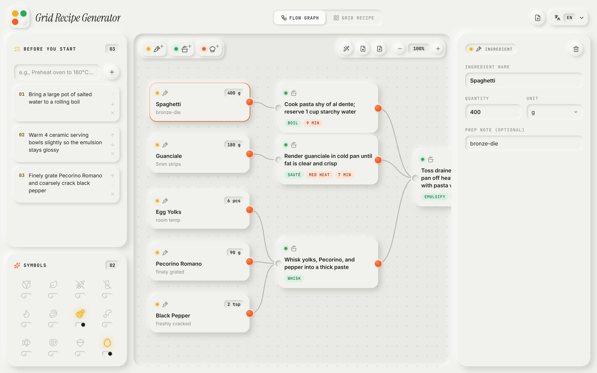

<div align="center">

# 🍝 Grid Recipe Generator

**Stop reading recipes like novels. See the whole dish at a glance.**

Draw your recipe as a flow (ingredients → steps → dish), and get a beautiful one‑page
**grid recipe card**, the kind professional kitchens pin to the wall.

[**▶ Try it live**](https://ericgozzi.github.io/recipe-designer/) ·
[Report a bug](https://github.com/ericgozzi/recipe-designer/issues) ·
[Suggest a feature](https://github.com/ericgozzi/recipe-designer/issues)




</div>

---

## Why a grid recipe?

A normal recipe is a wall of text: you read step 7 and scroll back to find how much butter
step 2 asked for. A **grid recipe** lays everything out in one table: ingredients on the
left, each column a stage of cooking, and merged cells show exactly which ingredients come
together in which step.

```
 INGREDIENTS        │ STAGE 01            │ STAGE 02             │ FINISH
────────────────────┼─────────────────────┼──────────────────────┼──────────────
 200 g guanciale    │ Render until crisp  │                      │
────────────────────┼─────────────────────┤ Toss off the heat,   │
 320 g spaghetti    │ Boil al dente       │ loosen with pasta    │  Carbonara
────────────────────┼─────────────────────┤ water until glossy   │
 4 yolks            │ Whisk with pecorino │                      │
 60 g pecorino      │ and black pepper    │                      │
```

One look tells you what to prep, what runs in parallel, and where it all meets.

## ✨ Features



- 🔀 **Visual flow editor**: drag nodes, wire ingredients into steps and steps into the dish.
  Invalid wires (cycles, wires into an ingredient) are refused for you.
- 🧮 **Automatic grid layout**: the graph is compiled into a clean merged-cell table, with
  shared steps split into aligned rows.
- 👥 **Cook for any number of people**: set what the recipe is written for and how many
  you're cooking for; every amount rescales instantly.
- 🖨️ **Perfect one-page PDFs**: A4 or A5 landscape, always fitted to exactly one page, with a
  true-to-size preview and an ink-saving black & white mode.
- ✅ **Cook along**: hover a cell to light up everything that feeds it, click to tick it off.
- 🏷️ **Categories and symbols**: vegan, gluten-free, spicy and more, printed on the card.
- 🌍 **7 languages**: English, Français, Italiano, Deutsch, Español, 日本語, Português.
- 📱 **Desktop, tablet and phone**.
- 🔒 **Private by design**: no account, no server. Everything is autosaved in your browser,
  and recipes export/import as plain `.json` files.
- 📦 **One file**: the build is a single self-contained `index.html` that works offline,
  straight from disk.

## 🚀 Quick start

Just want to use it? Open the **[live app](https://ericgozzi.github.io/recipe-designer/)**.

Want to hack on it?

```bash
git clone https://github.com/ericgozzi/recipe-designer.git
cd recipe-designer
npm install
npm run dev       # http://localhost:5173
```

```bash
npm run build     # -> dist/index.html, one self-contained file
npm run preview
```

## ⌨️ Handy shortcuts

| Action                         | How                                   |
| ------------------------------ | ------------------------------------- |
| Connect two nodes              | Drag from a node's blue port to another node |
| Delete selected node or wire   | `Delete` / `Backspace`                |
| Clear selection                | `Esc`                                 |
| Zoom around the cursor         | `Ctrl` + mouse wheel                  |
| Export a PDF                   | **PDF** button → "Save as PDF"        |

## 🗂️ Project layout

```
src/
  App.vue                 shell, keyboard shortcuts
  store.js                reactive state and every action (presets, editing, import, autosave)
  data/                   translations (i18n.js), presets, units, categories, symbols
  lib/grid.js             graph → merged-cell grid compiler, auto-layout
  components/             header, canvas, nodes, inspector, grid sheet, modals, toasts
  styles/base.css         design tokens and shared controls
```

## 🤝 Contributing

Contributions are very welcome, big or small:

- 🐛 **Found a bug?** [Open an issue](https://github.com/ericgozzi/recipe-designer/issues)
  with steps to reproduce (an exported `.json` recipe helps a lot).
- 🌐 **Speak another language?** Translations live in [src/data/i18n.js](src/data/i18n.js).
  Copy the `en` block and translate.
- 🍲 **Have a great recipe?** Example recipes live in [src/data/presets.js](src/data/presets.js).
- 💡 **Got an idea?** Open an issue to discuss it, or send a pull request.

To submit a change: fork the repo, create a branch, run `npm run build` to make sure it
builds, and open a pull request describing what changed and why.

## 🚢 Deploy your own

Every push to `main` builds the app and publishes it to GitHub Pages via
[.github/workflows/deploy.yml](.github/workflows/deploy.yml). On a fork, go to
**Settings → Pages → Build and deployment** and set **Source** to **GitHub Actions** once.

Or skip hosting entirely: `npm run build` and share `dist/index.html`.

## 📄 License

[MIT](LICENSE). Use it, fork it, cook with it.

<div align="center">

**If this made your kitchen a little calmer, please ⭐ the repo!**

</div>
